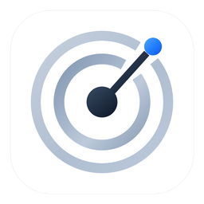

# Codex Reset Radar

A tiny macOS menu bar app that pings you when a Codex usage reset is announced,
with a countdown to when it lands.

Data from [codex-resets.com](https://codex-resets.com).

## Install

1. Download the [latest build](https://github.com/mpellicc/codex-reset-radar/releases/latest/download/CodexResetRadar.zip), unzip it and drag **Codex Reset Radar.app** to Applications.
2. Open it. macOS will refuse because the app isn't from an identified developer.
3. Go to **System Settings → Privacy & Security**, scroll down and click **Open Anyway** next to
   "Codex Reset Radar", then confirm. You only do this once.
4. Allow notifications when asked.
5. Click the radar icon in the menu bar and turn on **Launch at login**.

Requires macOS 13 or later.

## What it does

- Checks codex-resets.com every 15 minutes and after your Mac wakes.
- When a reset with a date is announced, sends a notification (and another if the time changes).
- Shows a countdown next to the menu bar icon (`9h`, `1h 59m`, `45m`, `due`) until it lands.

## Build

```bash
scripts/build-app.sh
```

Produces `dist/Codex Reset Radar.app` and `dist/CodexResetRadar-<version>.zip`.
Needs Xcode (for the universal arm64 + x86_64 build). See [SPEC.md](SPEC.md) for behaviour.

To format the code before committing, run `swift format --in-place --recursive Sources Tests`.

### Releasing

Releases are automatic; don't tag by hand or bump the version in `Resources/Info.plist`.

Every pull request needs one of these labels (a check enforces it):

| Label | Version bump | Releases on merge |
|---|---|---|
| `breaking` | major | yes |
| `enhancement` | minor | yes |
| `bug`, `accessibility` | patch | yes |
| `documentation`, `maintenance` | patch | no, waits for the next release |

On every merge to `main`, [Release Drafter](https://github.com/release-drafter/release-drafter)
updates a draft release with the notes and the next version. If the draft contains a change that
releases, the workflow builds and signs the app with that version, attaches
`CodexResetRadar-X.Y.Z.zip` and publishes the release, which creates the `vX.Y.Z` tag. The release
notes on GitHub are the changelog.

## License

The code is released under the [MIT License](LICENSE).

Reset data comes from [codex-resets.com](https://codex-resets.com) and is not covered by this
license. Anything that shows it must keep crediting codex-resets.com with a link, as
[SPEC.md](SPEC.md) requires.
